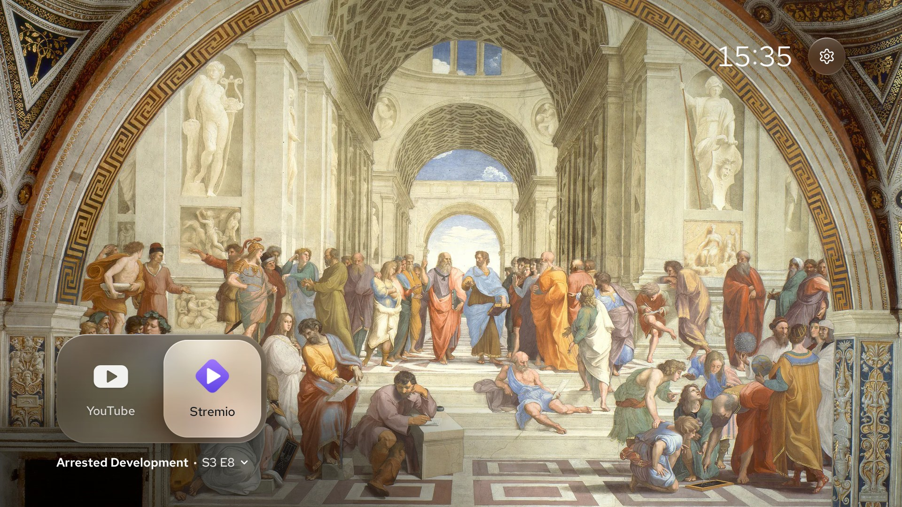
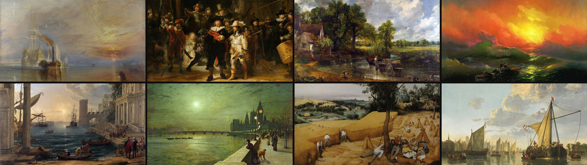
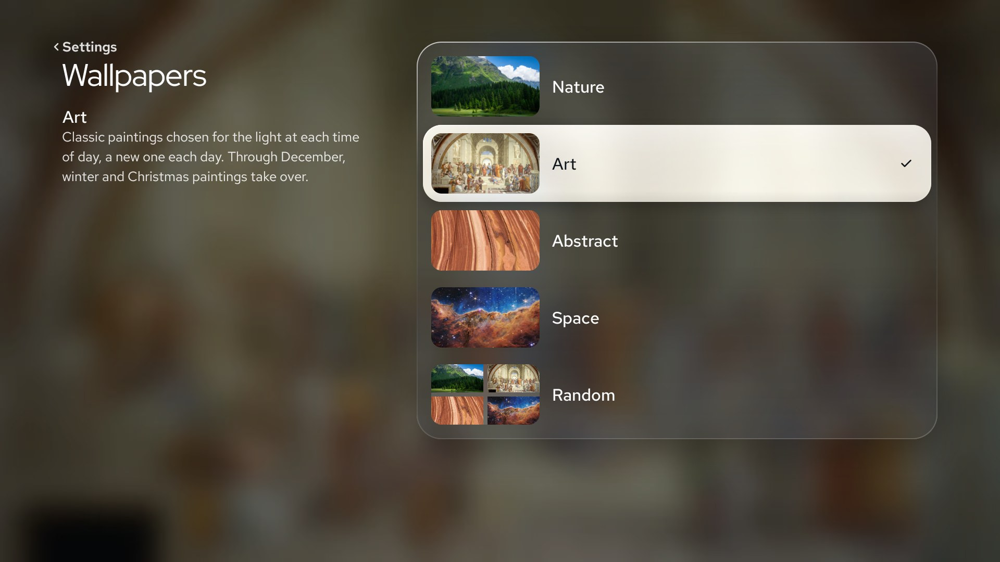
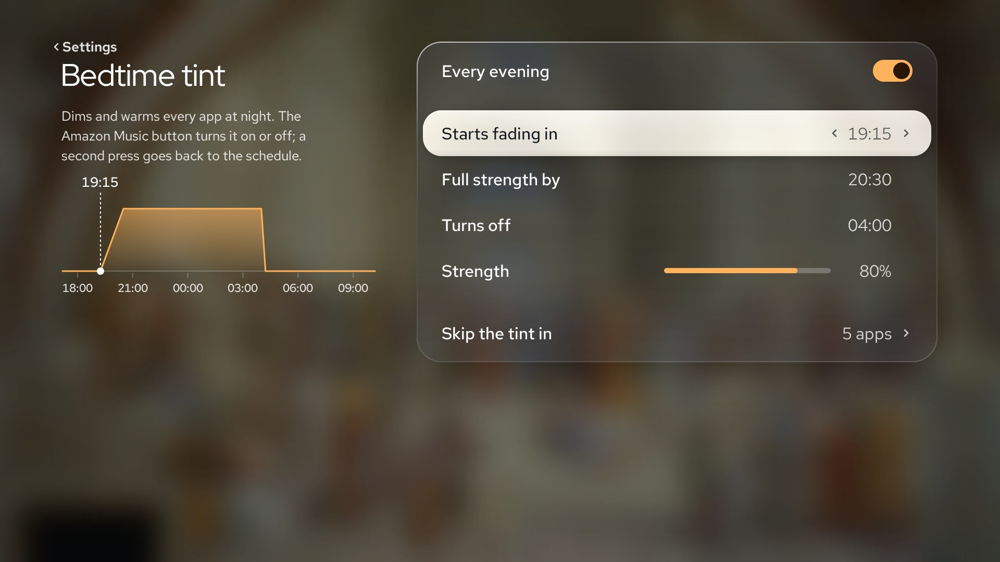
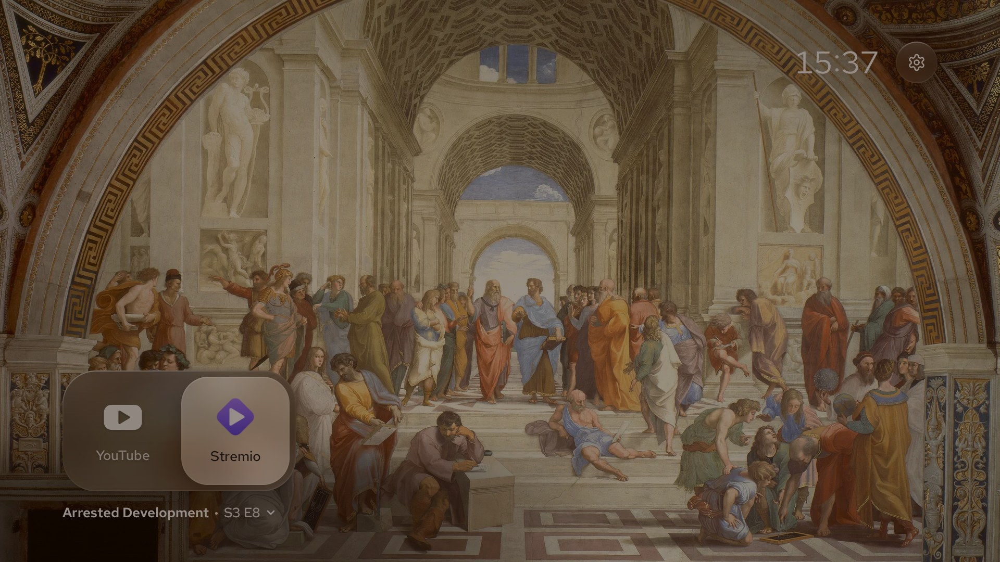
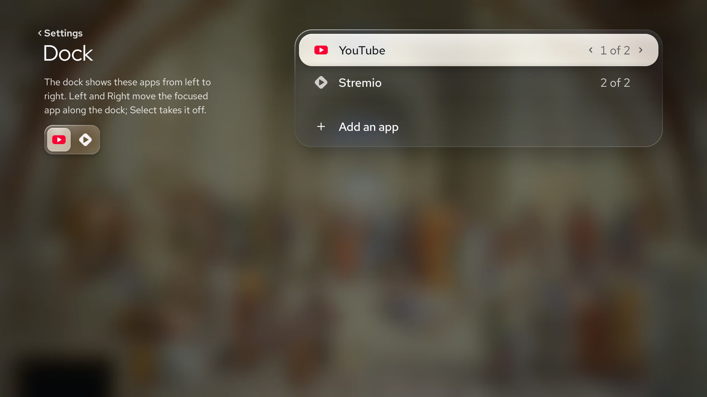
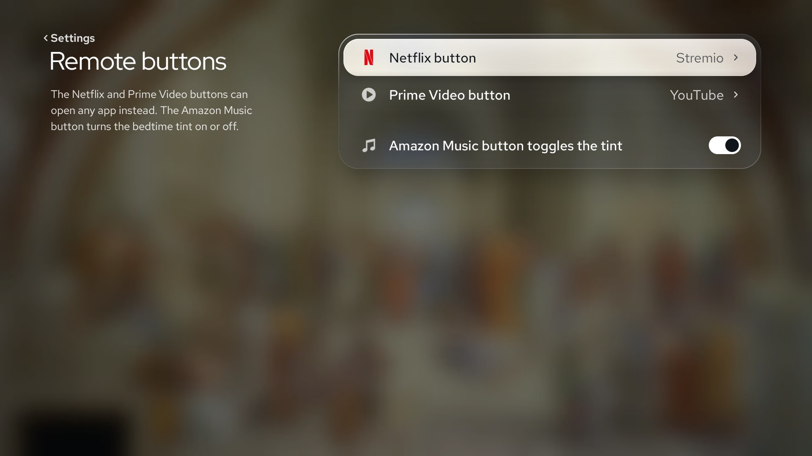
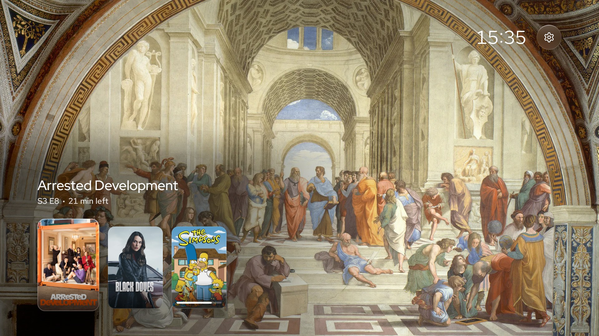
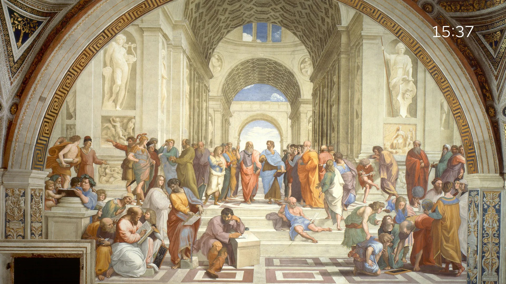

<h1 align="center">Fresco</h1>

<p align="center"><b>A calm, ad-free home screen for Fire TV.</b><br>
Replaces Amazon's billboard UI with a wallpaper that matches the time of day, a small dock for the apps you actually use, and a clock. Also fixes the other headaches on Fire OS: remaps the hardcoded remote buttons, adds a system-wide night shift, and shows your Stremio watch history.</p>

<p align="center"></p>

---

## Features

### Fast, reliable Home button hijacking

Amazon blocked custom default launchers on Fire OS years ago, and standard accessibility workarounds get hit by Android's 5-second app-switch delay every time you press Home.

Fresco gets around this: when Amazon's launcher wakes up, Fresco throws up a black cover so you never see an ad, and uses accessibility to click its own pinned tile on the stock home row. Because the foreground app is launching it, Android skips the 5-second penalty. Pressing Home from inside any app—or waking the TV from sleep—lands on Fresco in about half a second. Amazon's stock launcher stays untouched underneath as a fallback.

### Wallpapers that match the time of day

By default, Fresco rotates through 20 public-domain paintings matched to morning, afternoon, evening, and night—Constable's *Hay Wain* during the day, Turner's *Fighting Temeraire* at sunset, Rembrandt's *Night Watch* late at night. Every painting was hand-cropped to 16:9 so faces and subjects aren't cut in half, and 8 winter paintings rotate in during December.

If you don't want fine art on your TV, you can switch to Nature photography, Space (NASA/Webb), Abstract textures, or shuffle them. The Wallpapers page shows a thumbnail of each style. The clock picks light or dark ink for each picture, with no shadow or backing.

<p align="center"></p>
<p align="center"></p>

### System-wide night light (Bedtime tint)

Fire OS has no built-in blue-light filter or night shift, and blocks low-level display colour matrices. Fresco uses a system-wide accessibility overlay to dim and warm the screen across every app and video, fading in on a schedule in the evening and turning off in the morning.

- **One-button toggle:** Press the remote's Amazon Music button from anywhere (or Fast-Forward on the home screen) to toggle the tint on or off for the night. Press it again to return to your schedule. The Amazon Music shortcut can be turned off on the Remote buttons page.
- **DRM-safe:** Copy-protected apps like Prime Video and BBC iPlayer refuse to play video if an overlay is drawn above them. Fresco automatically disables the tint while those apps are in the foreground (you can edit the skip list in settings).

<p align="center"> </p>

### A minimal app dock

Instead of a grid of mismatched app banners, the dock holds 1 to 4 apps that you actually use daily, leaving 90% of the screen clear. Icons sit as quiet white marks at rest and light up in their brand colour when focused (30+ streaming and media apps are built in; anything else gets a clean monogram). Every other installed app is still one click away via the remote's **Apps** button.

On the Dock page, **Left/Right** moves an app along the dock. Press **Select** twice to remove it; the first press asks you to press again. A small preview shows the order.

<p align="center"></p>

### Remap the Netflix & Prime Video buttons

Fire TV remotes hardcode the shortcut buttons at the system level before normal remapper apps can see the key codes. Fresco intercepts the window launch instead and redirects the **Netflix** and **Prime Video** buttons to whatever installed app you want (e.g. Stremio and YouTube), while still letting you open Prime Video normally from the launcher.

<p align="center"></p>

### Stremio "Continue Watching" row

If you use Stremio, press **Down** on the home screen to pull up the shows and films you've watched in the past week. Selecting a poster jumps straight back into the episode in Stremio. If you don't use Stremio, the row stays completely out of the way.

<p align="center"></p>

### Ambient mode

Press **Rewind** on the home screen to hide the dock and settings button, leaving only the painting and the clock in the corner. Press any button to bring the UI back.

<p align="center"></p>

### Lightweight & completely reversible

Fire TV Sticks only have 1.5–2 GB of RAM, and heavy launchers cause background apps like Stremio or Plex to get killed. Fresco is written in plain Java with zero third-party libraries. It frees its wallpaper bitmaps the moment you open another app, uses 0% CPU at idle, and has no accounts, analytics, or network calls (aside from optional Stremio sync). It doesn't disable or modify any Amazon system packages, and uninstalling puts your Fire TV back to stock in seconds.

## Install

### Option 1: Let your coding agent do it

If you use Claude Code, Codex, Cursor, or OpenCode on a computer on the same Wi-Fi as your TV, paste this into your terminal:

> Install Fresco on my Fire TV. Follow AGENTS.md in https://github.com/rowesk/fresco-firetv-launcher

[`AGENTS.md`](AGENTS.md) walks the agent through enabling ADB with you, running the installer, and verifying the setup without touching any system packages.

### Option 2: Manual install (5 minutes)

1. **Enable ADB on the Fire TV:**
   - Go to *Settings → My Fire TV → About* and click **Select** on your device name 7 times to unlock Developer options.
   - Go back one menu to *Developer options* and turn **ADB debugging** ON.
   - Check your TV's IP address under *Settings → My Fire TV → About → Network*.
2. **Run the installer from your computer** (requires [`adb`](https://developer.android.com/tools/releases/platform-tools); on macOS run `brew install android-platform-tools`):

   ```sh
   git clone https://github.com/rowesk/fresco-firetv-launcher && cd fresco-firetv-launcher
   ./install.sh 192.168.1.50        # replace with your Fire TV's IP address
   ```

   When **"Allow USB debugging?"** pops up on the TV, tick *Always allow* and click **Allow**. The script downloads the latest APK, verifies its SHA-256 checksum, installs it, and enables Fresco's accessibility service alongside any you already use.
3. **Pin Fresco to Amazon's home row (important for speed):**
   Press the **Apps** button on your remote (three squares), highlight **Fresco**, press **Menu** (☰), and select **Move to front**. *(This puts the tile where Fresco's accessibility service can click it to bypass Android's 5-second Home button delay.)*
4. **Configure:**
   Click the settings cog at the top right of Fresco. Its six destinations are **Dock**, **Wallpapers**, **Bedtime tint**, **Remote buttons**, **Stremio**, and **Fire TV settings**. Amazon's settings open outside Fresco; Back returns here.

**Optional — Stremio Continue Watching:** Run `DEVICE=192.168.1.50:5555 app/tools/stremio-login.sh` from your computer. It prompts for your Stremio login locally and saves only the auth token to the stick.

### Compatibility

| Status | Devices |
|---|---|
| ✅ **Tested** | Fire TV Stick 4K Max (1st gen, `AFTKA`), Fire OS 7 |
| 🟡 **Should work** | Any Fire OS 6–8 device (Android API 25+): Fire TV Stick 4K, 4K Max (2nd gen), Lite, 3rd gen, Cube, Omni / 4-Series TVs. Open an issue if you test one! |
| ❌ **Unsupported** | Fire TV Stick 4K Select and newer **Vega OS** devices (Linux-based; cannot run Android APKs) |

### Uninstall

```sh
./install.sh --uninstall 192.168.1.50
```

Removes Fresco from your accessibility services, uninstalls the APK, and returns the Home button to Amazon's stock launcher.

## Under the hood

Fire OS locks down a lot of standard Android APIs. A few notes on how Fresco works around them:

- **Bypassing the 5-second Home delay:** Android blocks background services from launching activities for 5 seconds after `KEYCODE_HOME` is pressed (`STOP_APP_SWITCHES`), unless the launch comes from the currently visible app. When Amazon's launcher appears, Fresco's accessibility service immediately covers the screen in black, locates the pinned "Fresco" tile in Amazon's UI tree, and dispatches `ACTION_CLICK` on it—tricking Amazon's launcher into opening Fresco immediately. It also inspects interactive windows on `ACTION_SCREEN_ON` so waking from sleep works even when Amazon's launcher was already in the foreground.
- **Refractive glass on Android 9:** Fire OS (API 28) has no `RenderEffect` live blur, and blurring at 60 fps on a MediaTek TV chip drops frames. Because the wallpaper is static, Fresco pre-computes a ¼-scale box-blurred, saturation-boosted bitmap once when the wallpaper loads, then draws glass panels with a magnified `BitmapShader` and a higher-magnification lens rim. Glass contrast is solved in sRGB against a 32×18 grid. Text on the picture picks light or dark ink from the sharp image; the peek and Continue watching details get a soft bottom gradient only where neither ink holds its contrast target.
- **Zero-dependency build:** No Gradle, no AndroidX, no Kotlin runtime. The entire APK (~106 KB of compressed bytecode plus bundled WebP wallpapers and variable fonts) compiles in a couple of seconds via a shell script calling `aapt2`, `javac`, `d8`, and `apksigner` directly in [`app/build.sh`](app/build.sh).

Full UI architecture, solver maths, and motion curves are documented in [`docs/DESIGN.md`](docs/DESIGN.md).

## Building from source

Requires JDK 17, Android SDK Platform 28 + Build-Tools 34.0.0, Python 3 (`pillow`, `numpy`), and `cwebp`.

```sh
brew install openjdk@17 webp && pip3 install pillow numpy
app/build.sh                                                # outputs app/Fresco.apk
./install.sh 192.168.1.50 app/Fresco.apk
```

*Note: On the first build, `app/build.sh` downloads the Nature and Abstract wallpaper photos from Pexels and Unsplash. Their licences allow bundling inside an app binary, but not redistributing raw image files in a public repo.*

## Credits

- **Paintings:** Public domain via Wikimedia Commons ([full list & credits](wallpapers/art/CREDITS.md)).
- **Space imagery:** NASA (public domain) and ESA/Webb, ESA/Hubble & ESO (CC BY 4.0) ([credits](wallpapers/space/CREDITS.md)).
- **Nature & Abstract photography:** Photographers on Pexels and Unsplash ([nature](wallpapers/nature/CREDITS.md), [abstract](wallpapers/abstract/CREDITS.md)).
- **App icons:** Vector marks from [Simple Icons](https://simpleicons.org) (CC0) and custom-drawn SVGs ([credits](app/assets/marks/CREDITS.md)).
- **Typography:** Red Hat Display and Red Hat Text (SIL Open Font License).

Fresco is an independent project and is not affiliated with Amazon, Stremio, YouTube, or Netflix.

## Licence

Code is licensed under [MIT](LICENSE). Bundled wallpapers, icons, and fonts retain their respective licences above.
